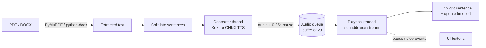
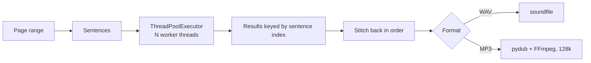

# Desktop Book Reader (AI Text-to-Speech)

A desktop app that reads PDF and Word documents aloud with the [Kokoro](https://github.com/thewh1teagle/kokoro-onnx) neural text-to-speech model, running fully locally on the CPU. It can also turn a page range into an audiobook file.

## Features
- Open **PDF** (via PyMuPDF) or **.docx** files
- Read aloud from a selection or from the cursor, with **live sentence highlighting** and a time-remaining estimate
- Pause / resume / stop, adjustable reading speed, 6 narrator voices (US and UK)
- **Export audiobooks** to WAV or MP3 for any page range, generated in parallel across CPU threads
- Modern dark UI built with CustomTkinter
- Downloads the Kokoro model and voices automatically on first run

## How it works

### Live reading: a producer / consumer pipeline
Speech is generated on one thread and played on another, so playback stays smooth while the next sentences are synthesized.



The playback thread writes audio in small 2048-sample chunks, which is what makes **Pause** respond instantly.

### Audiobook export: parallel synthesis


## Setup
```bash
pip install -r requirements.txt
python Desktop_Book_App_Complete.py
```
MP3 export requires [FFmpeg](https://ffmpeg.org/) on your PATH (used by `pydub`).

## Tech
Python · CustomTkinter · ONNX Runtime · Kokoro TTS · NumPy · sounddevice · PyMuPDF · python-docx · pydub · threading / concurrent.futures
